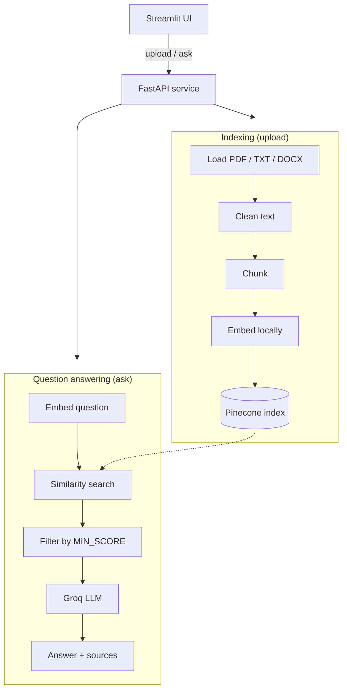

<div align="center">

# 🩺 Medical RAG Assistant

**Ask questions about your own medical documents and get answers grounded in the text, with source filenames and page numbers.**


</div>

A document-grounded medical information assistant. Upload PDF, TXT, or DOCX files, index their text in Pinecone, and ask questions in a Streamlit chat interface. The FastAPI service retrieves the most relevant chunks and sends them, with your question, to a Groq-hosted language model. Answers include source filenames and page numbers when the document loader provides page metadata.

> [!WARNING]
> This project is for learning and document search. It is **not a medical device** and does not replace a qualified healthcare professional. Answers depend on the documents you upload and may be incomplete or wrong. Do not use it for diagnosis, treatment decisions, emergencies, or as a substitute for professional advice.

## ✨ Features

- **Grounded answers:** the model is told to answer only from retrieved document text.
- **Source references:** every answer shows the supporting chunks with filename and page.
- **Safe fallback:** if nothing relevant is found, the app says it does not have enough information instead of guessing.
- **Multiple formats:** PDF, TXT and DOCX upload (up to 10 MB each).
- **Text cleaning:** removes repeated headers and footers, page numbers, blank pages and extra whitespace.
- **Filename filter:** restrict a question to one uploaded document.
- **REST API + chat UI:** FastAPI backend with interactive docs, and a Streamlit front end.
- **Tested and measurable:** 21 unit/API tests plus an evaluation script for retrieval, groundedness and latency.
- **Deployable:** includes a Render blueprint.

## 🧰 Tech stack

| Layer | Technology |
|---|---|
| Language | Python 3.12 |
| API | FastAPI, Uvicorn |
| UI | Streamlit |
| Orchestration | LangChain |
| LLM | Groq (default model `openai/gpt-oss-120b`) |
| Embeddings | Sentence Transformers `BAAI/bge-small-en-v1.5` (384 dimensions, runs locally) |
| Vector database | Pinecone serverless |
| Testing | Pytest |
| Deployment | Render |

## 🏗️ How it works



1. The UI sends an uploaded document to the FastAPI service.
2. The API extracts text, cleans it, splits it into overlapping chunks, and generates embeddings locally.
3. Vectors and chunk metadata are stored in a Pinecone serverless index. On first use the app creates the index if it does not exist.
4. When you ask a question, the API embeds it, retrieves the most similar chunks, and drops chunks below the configured similarity score.
5. The API sends the question and the retrieved text to Groq and returns the answer with its source chunks.

> [!NOTE]
> Model availability and account access can change. If you receive a model error, check Groq's [supported models](https://console.groq.com/docs/models).

## 📑 Contents

- [Quick start](#-quick-start)
- [Prerequisites](#-prerequisites)
- [Get API keys](#-get-api-keys)
- [Install and configure](#-install-and-configure)
- [Run the application](#-run-the-application)
- [Use the application](#-use-the-application)
- [Try it with the sample document](#-try-it-with-the-sample-document)
- [Run tests](#-run-tests)
- [Evaluate answers](#-evaluate-answers)
- [API endpoints](#-api-endpoints)
- [Configuration](#-configuration)
- [Deploy to Render](#-deploy-to-render)
- [Troubleshooting](#-troubleshooting)
- [Project layout](#-project-layout)
- [Privacy and security](#-privacy-and-security)
- [Future improvements](#-future-improvements)

## ⚡ Quick start

```powershell
git clone https://github.com/<your-username>/<your-repo>.git
cd <your-repo>
python -m venv venv
.\venv\Scripts\Activate.ps1
pip install -r requirements-dev.txt
pip install -r requirements-frontend.txt
Copy-Item .env.example .env        # then add your two API keys
```

Run the API in one terminal and the UI in another:

```powershell
uvicorn app.main:app --reload --port 8000
streamlit run frontend/streamlit_app.py
```

Open <http://localhost:8501>, upload a document, click **Index documents**, and ask a question.

## ✅ Prerequisites

- Python 3.12 recommended
- Internet access for package installation, the first embedding model download, Groq, and Pinecone
- A Groq API key
- A Pinecone API key and an account that can create serverless indexes
- Windows PowerShell for the main instructions (macOS/Linux commands are included)

## 🔑 Get API keys

1. Create or sign in to a Groq account at [console.groq.com](https://console.groq.com/) and create an API key.
2. Create or sign in to Pinecone at [pinecone.io](https://www.pinecone.io/) and create an API key.
3. Keep both keys private. Put them only in the local `.env` file or your hosting provider's secret settings. **Never commit `.env` to Git.**

## 🛠️ Install and configure

Run these commands from the project root. In VS Code, choose **File → Open Folder**, then **Terminal → New Terminal**.

**1. Check Python**

```powershell
python --version
```

**2. Create and activate a virtual environment**

```powershell
python -m venv venv
.\venv\Scripts\Activate.ps1
```

If PowerShell says script execution is disabled, allow activation for the current terminal only, then activate again:

```powershell
Set-ExecutionPolicy -Scope Process -ExecutionPolicy Bypass
.\venv\Scripts\Activate.ps1
```

The prompt should show `(venv)` when the environment is active.

**3. Install the packages**

```powershell
python -m pip install --upgrade pip
pip install -r requirements-dev.txt
pip install -r requirements-frontend.txt
```

> [!TIP]
> The first API startup downloads the embedding model (about 130 MB), so it takes longer than later starts.

**4. Create your environment file**

```powershell
Copy-Item .env.example .env
```

Open `.env` and replace the placeholders:

```dotenv
GROQ_API_KEY=paste_your_groq_key_here
PINECONE_API_KEY=paste_your_pinecone_key_here
```

Save the file. Do not add quotes unless they are part of the key. `.env` is ignored by Git.

<details>
<summary><b>macOS / Linux commands</b></summary>

```bash
python3.12 -m venv venv
source venv/bin/activate
python -m pip install --upgrade pip
pip install -r requirements-dev.txt
pip install -r requirements-frontend.txt
cp .env.example .env
```

Then edit `.env` and add the two API keys. Use the same `uvicorn` and `streamlit` commands shown below.

</details>

## ▶️ Run the application

The API and UI run in separate terminals. Keep both open while using the app.

**Terminal 1: FastAPI backend**

```powershell
.\venv\Scripts\Activate.ps1
uvicorn app.main:app --reload --port 8000
```

`--reload` restarts the API when source files change. Omit it for a normal run.

| Check | URL |
|---|---|
| Health | <http://localhost:8000/health> |
| Interactive API docs | <http://localhost:8000/docs> |

The health endpoint reports whether the two keys are *configured*. It does not verify that the keys are valid or that Groq and Pinecone are reachable.

**Terminal 2: Streamlit frontend**

```powershell
.\venv\Scripts\Activate.ps1
streamlit run frontend/streamlit_app.py
```

Streamlit prints a local URL, usually <http://localhost:8501>. In the sidebar, the API URL should be `http://localhost:8000` for a local backend.

To stop a service, focus its terminal and press **Ctrl+C**. After changing `.env`, restart the API so it reloads the settings.

## 💬 Use the application

1. Open the Streamlit page at <http://localhost:8501>.
2. Leave **API URL** as `http://localhost:8000` for local use.
3. Upload one or more PDF, TXT or DOCX files (each up to 10 MB).
4. Click **Index documents** and wait for the per-file success message.
5. Ask a question in the chat box. Answers use retrieved text from your indexed documents and show source excerpts, filenames and page numbers where available.
6. Use **Limit to one filename** to restrict retrieval to a single document, or **Show index stats** to see the Pinecone vector count.

> [!IMPORTANT]
> A scanned PDF that contains only page images has no extractable text. Run OCR on it first and upload the searchable PDF, or upload a text-based source. The app does not perform OCR.

**Storage:** vectors live in your Pinecone index and persist between runs. The default index name is `medical-rag`. Use a different `PINECONE_INDEX_NAME` if you want to keep this app's vectors separate from other data in the same Pinecone project.

## 🧪 Try it with the sample document

If you have `data/sample_health_guide.pdf` (a 6-page test guide covering diabetes, blood pressure, anemia and cold vs flu), upload it and try these questions.

**Should be answered from the document**

| Question | Expected in the answer |
|---|---|
| What are the symptoms of type 2 diabetes? | thirst, frequent urination, fatigue |
| What HbA1c level indicates diabetes? | 6.5 percent or higher |
| How much sodium should I limit per day for high blood pressure? | under 2,300 mg |
| Which foods are rich in iron? | lentils, spinach, red meat |

**Should be refused** (answer: *"I don't have enough information from the provided documents."*)

- Who won the 2011 Cricket World Cup?
- What is the correct paracetamol dose for a 2 year old child?

<!--
## 📸 Screenshots
Add images to docs/screenshots/ and uncomment:

| Chat with sources | Document upload |
|---|---|
|  |  |
-->

## 🧾 Run tests

With the virtual environment active and development requirements installed:

```powershell
pytest
```

The tests use fakes for external services, so they do not need working Groq or Pinecone keys. Expected result: **21 passed**.

## 📊 Evaluate answers

The evaluation script sends questions to the running API and compares retrieved text and answers with expected keywords. `evaluation/eval_questions.json` is an example; edit the questions, `expected_keywords` and `in_scope` values to match the documents you indexed.

With the API running, open another terminal in the project root, activate the virtual environment, and run:

```powershell
python -m evaluation.evaluate --api http://localhost:8000
```

To also have Groq judge whether answer claims are supported by the retrieved sources:

```powershell
python -m evaluation.evaluate --api http://localhost:8000 --judge
```

| Metric | Meaning |
|---|---|
| Retrieval relevance | An expected keyword appears in at least one retrieved chunk |
| Answer hit rate | An expected keyword appears in the answer |
| Correct refusals | Out-of-scope questions get the "not enough information" reply |
| Hallucination rate | Out-of-scope questions answered anyway, plus ungrounded answers with `--judge` |
| Latency | Mean and 95th percentile response time |

The report prints to the terminal and is saved to `evaluation/report.md` (excluded from Git). The `--judge` option makes extra Groq requests. This is a lightweight project metric; it does not establish clinical accuracy or safety.

## 🔌 API endpoints

| Method | Path | Purpose |
|---|---|---|
| `GET` | `/health` | Service status and whether the API keys are configured |
| `POST` | `/upload` | Upload and index one PDF, TXT or DOCX file (multipart form field `file`) |
| `POST` | `/ask` | JSON with `question` and optional `top_k`, `filename`; returns answer, sources and latency |
| `GET` | `/sources` | Retrieve source chunks without calling the LLM; needs a `question` query parameter, optional `top_k` and `filename` |
| `GET` | `/stats` | Pinecone index name and vector count |

Request examples are available at <http://localhost:8000/docs> while the API is running. The question limit is 1,000 characters, and `top_k` can be 1 to 10.

Example `/ask` request:

```json
{
  "question": "What symptoms does the document list?",
  "top_k": 4
}
```

## ⚙️ Configuration

Settings are read from environment variables and `.env`. Variable names are uppercase (for example `LLM_MODEL`).

| Environment variable | Default | Purpose |
|---|---|---|
| `GROQ_API_KEY` | empty | Groq API key; required for generated answers |
| `PINECONE_API_KEY` | empty | Pinecone API key; required for indexing and retrieval |
| `PINECONE_INDEX_NAME` | `medical-rag` | Serverless index name |
| `PINECONE_CLOUD` | `aws` | Pinecone serverless cloud provider |
| `PINECONE_REGION` | `us-east-1` | Region used when creating the index |
| `LLM_MODEL` | `openai/gpt-oss-120b` | Groq chat model ID |
| `EMBEDDING_MODEL` | `BAAI/bge-small-en-v1.5` | Local embedding model (must output 384 dimensions for the default index) |
| `EMBEDDING_DIMENSION` | `384` | Vector size; must match the model and the Pinecone index |
| `CHUNK_SIZE` | `800` | Chunk size in characters |
| `CHUNK_OVERLAP` | `150` | Overlap between adjacent chunks, in characters |
| `TOP_K` | `4` | Chunks retrieved per question |
| `MIN_SCORE` | `0.35` | Similarity threshold; chunks below it are discarded |

Optional settings go on their own lines in `.env`:

```dotenv
PINECONE_INDEX_NAME=medical-rag
LLM_MODEL=openai/gpt-oss-120b
TOP_K=4
MIN_SCORE=0.35
```

> [!CAUTION]
> If you change the embedding model, make sure its output dimension matches `EMBEDDING_DIMENSION` and the dimension of the Pinecone index. An existing index cannot accept vectors of a different dimension.

## 🚀 Deploy to Render

The included `render.yaml` defines two web services: `medical-rag-api` and `medical-rag-ui`.

1. Push the project to GitHub. Make sure `.env` is not committed (`.gitignore` excludes it).
2. In Render, choose **New → Blueprint** and connect the repository that contains `render.yaml`.
3. Create the services from the blueprint.
4. On the API service, add `GROQ_API_KEY` and `PINECONE_API_KEY` as secret environment variables.
5. Deploy the API and check `https://<api-service-name>.onrender.com/health`.
6. Set the UI service's `API_URL` to the API service URL (for example `https://medical-rag-api.onrender.com`), then deploy the UI.
7. Open the UI URL and upload a document to confirm it can reach the API.

The blueprint uses the Render **Starter** plan for the API because loading the embedding model needs more memory than the 512 MB free plan usually provides. The UI uses the free plan. Plans and limits can change, so confirm current costs in Render before deploying. Never put API keys in source files or the Git repository.

## 🩹 Troubleshooting

| Symptom | What to check |
|---|---|
| `503` and `GROQ_API_KEY is not set` | Confirm `.env` exists in the project root with `GROQ_API_KEY=...`, then restart the API |
| Groq returns `404 model_not_found` | The model may be retired or not enabled for your account. Set `LLM_MODEL` in `.env` to a model your Groq account can use (default: `openai/gpt-oss-120b`) and restart. See Groq's [model list](https://console.groq.com/docs/models) |
| `503` and Pinecone unavailable | Check `PINECONE_API_KEY`, the Pinecone project, and whether your account can create serverless indexes in the configured cloud and region |
| UI cannot reach the API | Make sure the API terminal is still running and the sidebar API URL is correct (local default `http://localhost:8000`) |
| Answers always say there is not enough information | Check that indexing succeeded and the document contains the answer. Try lowering `MIN_SCORE` (for example `0.2`) and restart the API |
| `No readable text found` | The file may be blank or a scanned PDF. OCR scanned pages first |
| Upload is rejected | Only `.pdf`, `.txt` and `.docx` files up to 10 MB are accepted by default |
| Port 8000 or 8501 already in use | Stop the other process, or run on another port and update the API URL |
| Package installation fails | Confirm Python 3.12 is selected, the virtual environment is active, and you have internet access |

## 📁 Project layout

```text
RAG-PRO/
├── app/
│   ├── api/              # FastAPI routes
│   ├── chains/           # Retrieval and answer generation pipeline
│   ├── embeddings/       # Local embedding model
│   ├── loaders/          # PDF, TXT, DOCX loading and chunking
│   ├── prompts/          # Grounded-answer prompt
│   ├── services/         # Groq LLM integration
│   ├── utils/            # Text cleaning and validation
│   ├── vectorstore/      # Pinecone integration
│   ├── config.py         # Environment-based settings
│   ├── dependencies.py   # Shared API dependencies
│   ├── exceptions.py     # Application errors
│   └── main.py           # FastAPI application
├── data/                 # Local placeholder; uploads are processed temporarily
├── docs/                 # Documentation space
├── evaluation/           # Evaluation questions and runner
├── frontend/             # Streamlit UI
├── tests/                # Unit and API tests
├── .env.example          # Environment variable template
├── .gitignore
├── pytest.ini
├── render.yaml           # Render blueprint
├── requirements.txt      # API dependencies
├── requirements-dev.txt  # API plus test dependencies
└── requirements-frontend.txt
```

## 🔒 Privacy and security

- Keep `.env` private, and rotate a key immediately if it is exposed.
- Uploaded file bytes are processed through a temporary file and deleted after ingestion. Extracted chunks and embeddings are stored in Pinecone. Prompts containing retrieved chunks and your question are sent to Groq to generate answers.
- Use only documents you are permitted to process, and review Groq and Pinecone data-handling terms before uploading sensitive or identifiable health information.
- The local app is intended for development. Before exposing it publicly, add authentication, restrict CORS origins, use secure secret management, and review upload and data-retention requirements.

## 🔭 Future improvements

- Re-ranking and hybrid (keyword + semantic) search
- Streaming answers in the UI
- Conversation memory for follow-up questions
- Authentication and rate limiting
- OCR support for scanned PDFs

## 👩‍💻 Author

**Ganga Maheswari Bathula**: [GitHub](https://github.com/<your-username>) · [LinkedIn](https://www.linkedin.com/in/<your-profile>)